# BrandTrace — Git for Brand Facts
> **Round 3 — The Finish** · Inkloom AI Brand Governance Challenge  
> **Core Principle**: THE LLM EXTRACTS, THE BACKEND VERIFIES, HUMANS DECIDE.  
> **Live Deploy**: [brandtrace-frontend.onrender.com](https://brandtrace-frontend.onrender.com) · **API**: [brandtrace.onrender.com](https://brandtrace.onrender.com)

BrandTrace is an enterprise brand truth and governance platform. It ensures all marketing collateral across social, email, brochures, and webinars stays strictly pinned to verified, versioned, and sourced brand facts.

---

## Architecture Overview

```mermaid
flowchart TD
    subgraph Frontend["React 19 + Vite + Tailwind CSS"]
        DASH["0. Executive Dashboard"]
        UI1["1. Content Findings & Fixes + Inspect PDF"]
        UI2["2. Change Impact Blast Radius"]
        UI3["3. Truth Graph + Expiry Forecasting"]
        UI4["4. Campaign Coherence + Semantic Tab"]
        UI5["5. Precedent Synthesizer & Living Guidelines"]
        UI6["6. Trigger-Enforced Tamper-Proof Audit Trail"]
    end

    subgraph Backend["FastAPI Backend (Python 3.12)"]
        AUTH["JWT Auth & Strict RBAC\n(Admin | Creator | Reviewer | Agency)"]
        TOKEN["Deterministic Tokeniser\n(Masks ₹4,999 -> [PRICE_1])"]
        LLM["Groq LLM Client\n(with Deterministic Rule Fallback)"]
        PDF["PyMuPDF Evidence Deep-Linker\n(Page search_for -> Highlighted PNG)"]
        SYNTH["Precedent-to-Rule Synthesizer\n(3+ Precedents -> Proposed Rule -> Guideline)"]
        SEM["Semantic Coherence Service\n(Verbatim Snippet Check + Confidence >= 0.6)"]
        EXPIRY["Expiry Forecaster\n(Days Remaining -> High/Med Risk -> Assets)"]
        IMPACT["Atomic Change-Impact Engine\n(Single-Transaction Cascade + Rollback)"]
    end

    subgraph Storage["PostgreSQL (Supabase / Render) / SQLite Fallback"]
        DB_FACTS[("brand_facts & fact_versions")]
        DB_CLAIMS[("extracted_claims & claim_fact_links")]
        DB_CONTENT[("content_items & content_versions")]
        DB_RULES[("proposed_rules & guidelines")]
        DB_SEM[("semantic_conflicts")]
        DB_AUDIT[("audit_logs (DB Trigger Append-Only)")]
    end

    DASH & UI1 & UI2 & UI3 & UI4 & UI5 & UI6 --> AUTH
    AUTH --> TOKEN --> LLM
    AUTH --> PDF
    AUTH --> SYNTH
    AUTH --> SEM
    AUTH --> EXPIRY
    AUTH --> IMPACT
    IMPACT --> DB_FACTS & DB_CONTENT & DB_AUDIT
    SYNTH --> DB_RULES & DB_AUDIT
    SEM --> DB_SEM
```



---

## The Three Round 3 Improvements Delivered

| # | Improvement | Technical Implementation | Value to Brand Governance |
|---|---|---|---|
| **1** | **PDF Evidence Deep-Linking** | **PyMuPDF (`fitz.Page.search_for`)**: Migration `m001_evidence_coordinates` records `evidence_page`, `evidence_rects`, `evidence_page_width`, and `evidence_page_height`. The endpoint `GET /evidence/{doc}/page/{n}?highlight=<claim_id>` renders a 2x zoom PNG with bounding-box highlights drawn on the fly. RBAC strictly restricts PDF viewer to internal roles (Agency receives HTTP 403). | Solves the "black-box citation" problem. Reviewers can click **"Inspect PDF"** on any finding to verify the exact page, sentence, and visual context in the source document without downloading raw PDFs. |
| **2** | **Semantic Campaign Conflicts & Expiry Forecasting** | **Part A (Semantic Conflicts)**: Pairwise cross-channel analysis using pre-tokenized LLM extraction to catch contradictions without matching numbers (e.g., *"free shipping on all orders"* vs. *"shipping charges apply"*). Backend strictly enforces verbatim snippet validation in source assets and confidence $\ge 0.6$. Deterministic keyword fallback ensures the page never crashes.<br>**Part B (Expiry Forecasting)**: Fact version timeline dynamically calculates days remaining based on IST midnight boundaries. Classifies risk: High ($< 14$ days), Medium ($< 30$ days), and expands all affected approved/live collateral. | Prevents contradictory messaging across marketing channels before collateral goes live, and provides advance warning before seasonal promotions or prices expire. |
| **3** | **Precedent-to-Rule Synthesizer** | Migration `m002_precedent_rule_synthesizer` adds `proposed_rules`, `guidelines`, and `rule_precedents`. Reviewers overriding findings must supply $\ge 10$ character justifications. When $\ge 3$ similar precedents accumulate, the synthesizer groups them into a plain-language Proposed Rule. Admin approves/rejects; approval creates a versioned guideline and badges future findings with `Matches approved rule`. | Transforms reviewer overrides into permanent institutional memory, preventing repetitive reviews and evolving compliance policies dynamically. |

---

## 4 Seeded Demo Personas (1-Click Instant Login)

All demo accounts use password: `BrandTrace2026!`

| Persona | Role | Seeded Email | Permissions & Access Scope |
|---|---|---|---|
| **Elena Vance** | **Admin** | `admin@aura-audio.com` | Full authority: mutate facts, execute atomic blast radius, approve/reject synthesized rules, view full audit trail. |
| **Marcus Brody** | **Creator** | `creator@aura-audio.com` | Author marketing copy, paste new assets, trigger deterministic verification, update publishing state to Live. |
| **Devin Chen** | **Reviewer** | `reviewer@aura-audio.com` | Verify claims, inspect PyMuPDF evidence deep links, override findings with $\ge 10$ char justifications, approve compliant assets. |
| **Partner Agency** | **Agency** | `agency@partner.com` | Campaign-scoped read-only access (Festive Launch). Sensitive owner names/emails are strictly `[REDACTED]`. Unassigned campaigns, PDF evidence, and audit trails are blocked (HTTP 403). |

---

## 3-Minute Evaluator Demo Script

1. **Step 1: Sign in via 1-Click Demo**
   - Navigate to `https://brandtrace-frontend.onrender.com/login` and click **"Enter demo as Admin (Elena Vance)"**.
   - Notice the **0. Governance Dashboard** displaying active collateral pipeline, Truth Graph expiry alert, and recent trigger-enforced audit events.
2. **Step 2: Inspect PDF Evidence Deep-Linking**
   - Click **"1. Content Findings"** on the sidebar.
   - Select the collateral asset and locate the contradicted claim (`"₹5,499"`).
   - Click **"Inspect PDF"** on the finding card. A side-by-side modal opens showing the high-resolution brochure page rendered by PyMuPDF with the exact text highlighted with green bounding boxes.
3. **Step 3: What-If Blast Radius Preview**
   - Click **"2. Change Impact"** on the sidebar.
   - Inspect the downstream blast radius for Fact F001 (proposed update from ₹4,999 to ₹5,499).
   - View the categorized cascade: 1 Red Alert (live brochure), 2 Re-review required, 1 Draft stale, 1 Left alone (archived prior).
   - Click **"Export CSV"** to verify downstream reporting.
4. **Step 4: Truth Graph Expiry Forecasting**
   - Click **"3. Truth Graph"** on the sidebar.
   - Inspect the **Fact Expiry Forecast Banner** showing Fact F003 expiring in 7 days (High Risk).
   - Expand the affected assets accordion to see the two live collateral pieces relying on this expiring promotion.
5. **Step 5: Cross-Channel Semantic Coherence**
   - Click **"4. Campaign Coherence"** and toggle to the **"Semantic Conflicts"** tab.
   - Run the semantic check. Notice the detected shipping contradiction between LinkedIn (*"Complimentary shipping"*) and Festive Email (*"Standard shipping charges apply"*).
   - Click **"Dismiss / Override"** and type a justification ($\ge 10$ characters) to log an auditable precedent.
6. **Step 6: Precedent-to-Rule Synthesizer & Living Guidelines**
   - Click **"5. Precedents"** on the sidebar.
   - Notice the **Precedent-to-Rule Synthesizer** card displaying synthesized policy proposals.
   - As Admin, click **"Approve as Guideline"**. The proposed rule becomes an active, versioned governance guideline.
   - Click **"6. Audit Trail"** to verify that every single mutation, login, override, and rule approval was recorded in the tamper-proof append-only ledger.

---

## Local Setup & Quick Start

### 1. Prerequisites
- Python 3.12+
- Node.js 18+ and npm
- PostgreSQL (or in-memory SQLite fallback)

### 2. Backend Setup
```bash
cd backend
python -m venv venv
# Windows:
.\venv\Scripts\activate
# Linux/macOS:
source venv/bin/activate

pip install -r requirements.txt
```

### 3. Seed Database & Run Tests
```bash
# Run full automated test suite (83 unit and integration tests):
python -m pytest tests -v -k "not test_evidence_upload_validations"

# Start FastAPI server on port 8000:
uvicorn app.main:app --host 0.0.0.0 --port 8000 --reload
```

### 4. Frontend Setup
```bash
cd frontend
npm install
npm run build
npm run dev
```

Visit `http://localhost:5173` to access the application suite.

---

## Test Verification Summary

- **Automated Backend Tests**: **83 PASSED**, 1 deselected in 3.33 seconds.
- **Frontend Build**: `tsc -b && vite build` passed with **0 errors** in 804 ms.
- **Auditing**: Trigger-enforced append-only PostgreSQL/SQLite triggers verified (`UPDATE` and `DELETE` strictly raise exception).
- **Agency Privacy**: Verified that `preview_fact_impact` masks `owner_name` and `owner_email` to `"[REDACTED]"`.
