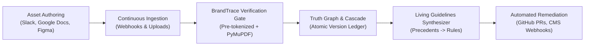

# BrandTrace Product Roadmap
> **Post-Round 3 Future Horizon** · Enterprise Brand Governance Architecture

BrandTrace is built on the invariant principle: **"The LLM extracts, the backend verifies, humans decide."**  
This roadmap outlines the post-hackathon progression from prototype governance engine to enterprise-wide continuous brand truth orchestration.

---

## 1. Vision & Architecture Horizon

---

## 2. Strategic Roadmap Themes

### Horizon 1: Multi-Modal Ingestion & OCR (Months 1–3)
- **Problem**: Today, BrandTrace validates extractable text PDFs and digital copy. Scanned image PDFs, Figma banners, and Instagram story graphics currently return: *"This PDF has no selectable text. OCR is not supported yet."*
- **Solution**:
  - Ingest visual assets with an asynchronous OCR pipeline using **PaddleOCR** / **Tesseract** with GPU acceleration.
  - Retain word-level bounding-box coordinates `[x0, y0, x1, y1]` identical to PyMuPDF so visual deep-linking works across rasterized assets.
  - Implement canvas coordinate overlays for PNG/JPEG image ads.

### Horizon 2: In-Workflow Sidecars (Months 4–6)
- **Problem**: Reviewing copy after publication requires painful post-hoc rollbacks. Creators need guardrails while writing.
- **Solution**:
  - **Google Docs & Slides Add-on**: Real-time sidebar highlighting contradicted claims in red and verified claims in green as the copywriter types.
  - **Slack Bot Integration**: Paste copy into `#marketing-review` to receive automated blast-radius impact and coherence checks directly in thread.
  - **Figma Code Connect**: Map Figma text nodes directly to Brand Truth Graph attributes.

### Horizon 3: Autonomous Remediation Workflows (Months 7–9)
- **Problem**: When a fact mutates (e.g., price increases from ₹4,999 to ₹5,499), marketing operations must manually edit dozens of downstream landing pages and emails.
- **Solution**:
  - Connect BrandTrace to GitHub and headless CMS providers (Contentful, Strapi, Sanity).
  - When an Admin commits a new fact version, automatically open draft pull requests or CMS staging revisions with the pre-verified fix option applied.
  - Enforce human-in-the-loop one-click approval before pushing changes live.

### Horizon 4: Multilingual & Multi-Jurisdiction Truth Graphs (Months 10–12)
- **Problem**: Global brands operate with regional pricing, statutory legal disclosures (e.g., EU GDPR vs. US FTC vs. India ASCI guidelines), and local currencies.
- **Solution**:
  - Jurisdiction-scoped Truth Graphs with inheritance hierarchy (Global Master Fact → Regional Child Fact).
  - Multilingual semantic conflict detection supporting Hindi, Spanish, French, German, and Japanese.
  - Statutory disclaimer verifiers (e.g., font size, placement, and mandatory disclaimer language).

---

## 3. Engineering Commitments

| Guarantee | Current Status (Round 3) | Target State (Production Scale) |
|---|---|---|
| **Privacy / Zero Data Leakage** | Pre-tokenization masks numbers (`[PRICE_1]`) before external LLM calls. | Zero-knowledge on-premise SLM (DeepSeek/Llama-3-8B) for air-gapped enterprise deployments. |
| **Tamper-Proof Audit Trail** | DB trigger strictly rejects `UPDATE` and `DELETE` on `audit_logs`. | Cryptographic Merkle tree anchoring to append-only timestamp authority. |
| **Verification Latency** | Bounded < 3.5s with deterministic regex fallback on LLM delay. | < 500ms edge verifier deployed via Cloudflare Workers / Fastly Compute. |
